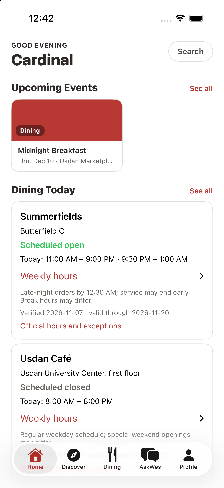
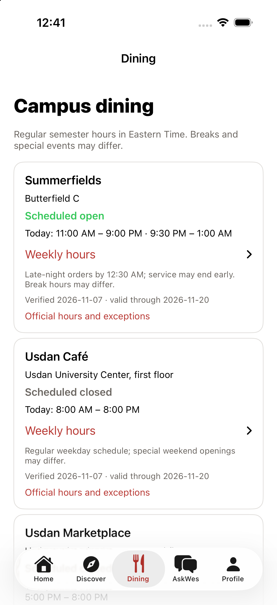
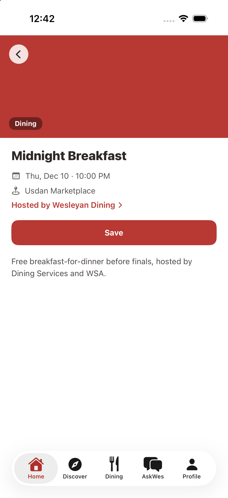

# MyWes

### Your campus, all in one place.

Campus life, connected—from dining and events to resources and advice.

**Swift · SwiftUI · Supabase · PostgreSQL · Google OAuth**

[Screenshots](#screenshots) · [Product vision](#product-vision) · [Engineering](#engineering) · [Project status](#project-status) · [Run locally](#run-locally)

---

**MyWes** is an iOS campus app that brings dining menus, campus events, and working hours for all Wes resources into one place. Its community forum, **AskWes**, lets students ask questions about choosing a major, planning their future, and navigating life at Wesleyan while sharing advice and experiences.

## Screenshots

| | | |
| :---: | :---: | :---: |
|  |  |  |

## Product vision

MyWes is being built as one place to navigate Wesleyan—from deciding where to eat and finding something to do, to getting advice on decisions that shape life during and after college. The experiences below describe the intended product.

| Experience | What MyWes is designed to offer |
| --- | --- |
| **Dining** | Find campus dining locations, explore menus and food options, and check hours before heading out. Student reviews are a possible future addition. |
| **Events & organizations** | Discover what is happening on campus, find communities around your interests, save events, and follow organizations you care about. |
| **Wesleyan resources** | Find working hours for resources across Wes, so students can plan around when services are available. The goal is campus-wide coverage beyond dining. |
| **AskWes** | Ask meaningful questions about majors, academic choices, future plans, and everyday campus life. Connect with upperclassmen and, as alumni access is developed, graduates who can share experience beyond Wesleyan. |
| **Your campus, personalized** | Keep saved events, followed organizations, and interests together to make campus life easier to navigate. |

## Engineering

Built in **Swift** and **SwiftUI**, with **Supabase Auth** and **PostgreSQL** supporting persistent campus and student data.

- **Shared application state:** `AppSession` coordinates authentication, profile, catalog, and community services using Swift Observation and asynchronous data access.
- **Responsive engagement:** saves and follows update optimistically, roll back on failure, and serialize changes per item to avoid conflicting writes.
- **Database-enforced access:** PostgreSQL row-level security protects student-owned saves, follows, profiles, and Q&A writes. The database assigns Q&A authorship; students can delete only their own contributions.
- **Secure authentication:** Google OAuth uses PKCE and Keychain-backed session storage. Provider secrets stay on the backend; the app uses a publishable/anon key.
- **Time-aware dining:** schedule calculations handle Eastern Time, overnight service, and expiration dates so outdated schedules do not claim a location is open.

## Project status

**Working iOS MVP · Source available · In active development**

The current app includes Google sign-in, event and organization discovery, persistent saves and follows, catalog search, AskWes questions and answers, profile editing, and dining schedules for Usdan Marketplace, Summerfields, and Usdan Café. Dining also provides access to official Bon Appétit menu pages inside the app.

Campus-wide resource hours, alumni participation, native menu listings, and dining reviews are planned extensions of the product vision. Menus currently use the official website; the new menu sheet has passed a Debug build and awaits simulator interaction testing. Catalog records are maintained through the backend.

MyWes is available to build from source and is not yet distributed through the App Store or TestFlight. Hosted Google sign-in currently requires an approved Wesleyan test account while OAuth remains in Testing.

### Validation

- **Live backend checks:** Google login, session restoration, event and organization browsing, saves/follows across app restarts, Q&A posting/search/deletion, profile saving, and dining schedules exercised in the iOS simulator against hosted Supabase.
- **Builds:** signed Debug and Release simulator builds passed during core MVP verification.
- **Regression coverage:** production data serialization, authentication errors, and dining time calculations, plus **37 database permission and persistence assertions** in isolated PostgreSQL.

Physical-device testing and additional failure-path checks remain. Full results and test boundaries are recorded in the [verification notes](docs/VERIFICATION.md); commands are in the [development guide](docs/DEVELOPMENT.md).

## Run locally

1. Open `MyWes/MyWes.xcodeproj` in Xcode and select the **MyWes** scheme. The project currently targets **iOS 26.5**.
2. Copy `MyWes/Config/Secrets.example.xcconfig` to `MyWes/Config/Secrets.xcconfig` and supply your Supabase URL and publishable/anon key.
3. Apply the included database migrations to your own Supabase project, configure Google OAuth and the Wesleyan email hook, and allow the `mywes://auth-callback` redirect.
4. Build and run on a compatible simulator, then sign in with an authorized `@wesleyan.edu` Google account.

The [development guide](docs/DEVELOPMENT.md) includes complete backend setup, secret handling, architecture details, and test commands.

## Author

Built by [Edomias Zerihun](https://github.com/eddy090909).
